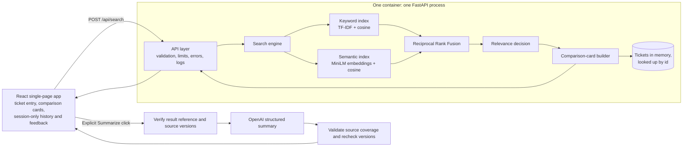

# Solution Design: Support Ticket Similarity Assistant

**Status (2026-11-17).** The application is built and runs locally and in a container; every claim below marked *measured* comes from a command that was run. **The AWS deployment is prepared but has not been performed.** Detailed walkthroughs, tables and source references are in [TECHNICAL_APPENDIX.md](TECHNICAL_APPENDIX.md).

## 1. The problem, in my own words

Solari Analytics' support team receives about 150 new tickets a day. An agent often does not know that a colleague already solved a very similar ticket, so they investigate from scratch or, worse in the customer's words, give a different answer than another customer received. Volume is expected to grow.

The assistant does one thing: **for a new ticket, it retrieves past resolved tickets that look like the same problem, shows their original resolutions word for word, and gives the agent the evidence needed to judge whether a past resolution applies.** It retrieves evidence. It does not resolve tickets.

| The application | The human agent |
|---|---|
| Retrieves and ranks candidate past tickets | Decides whether a past ticket is really the same problem |
| Shows the stored resolution verbatim, with the wording both tickets share | Investigates and resolves the ticket |
| States differences and unknowns it can read from the text | Performs any refund, reset, account change or closure |
| Says plainly when nothing in the history is a strong match | Handles new kinds of problem from scratch |

## 2. Assumptions

| Assumption | Why |
|---|---|
| "Similar" means the same symptom in the same product area, so the past resolution is a sensible first thing to check | Shared words or a shared category are not enough: one supplied example shares its topic with a past ticket whose fix would not help |
| The agent types or pastes the ticket; nothing is fetched from a helpdesk | The brief names no helpdesk system |
| History reaches tens of thousands of tickets within a year (150 a day is roughly 39,000 to 55,000) | Derived from the stated volume; the growth factor is not given |
| The 40 supplied tickets are a sample, not Solari's history | The brief calls it a seed dataset |
| Internal tool on synthetic data, no sign-in | The dataset has no customer or ownership field, so access isolation **cannot be demonstrated and is not claimed** |

Data limits that shape the design: new tickets carry only a subject and description; every past ticket is "resolved"; there is no record of what the customer was told, no resolution date, and no answer key.

## 3. Approach

**Once, at build and start-up:** validate the ticket file, fit the TF-IDF vocabulary, load the model, load the precomputed embeddings after checking they match the running model and data. **Per request:** validate, score against both indexes, fuse the rankings, decide what is worth showing, build a card per result.

1. **Two retrievers, because each fails differently.** Keyword search misses a problem described in other words; meaning-based search rates "Snowflake integration failing" close to "HubSpot integration failing". Neither is treated as right on its own.
2. **Ranking and relevance are separate.** Reciprocal Rank Fusion only merges two orderings; the best of a bad list scores the same as the best of a good list. A separate step reads the raw evidence (keyword cosine, embedding cosine, and *coverage*: how much of the new ticket's wording the past ticket accounts for) and labels each candidate *close match* or *related context*, or drops it. The user chooses Top 3 or Top 5; this maximum is applied after relevance filtering and the list is never padded.
3. **Scores are not probabilities.** The interface shows labels and evidence, never a percentage.
4. **Four honest outcomes:** too vague to search; no strong match; keyword-only results because the model is unavailable; service failure. Each has its own screen.
5. **The comparison card is deterministic.** Every line is stored text, an exact-word comparison, a missing field shown as unknown, or a fixed question template. A separate, optional Summarize button calls an LLM on exactly the displayed main matches. Signed result references and source-version checks prevent silently substituting other records. The summary cites sources and preserves uncertainty; it is labelled generated and must be checked against the originals. It cannot alter retrieval or perform a resolution.
6. **One container; tickets in JSON or PostgreSQL.** 40 tickets fit in memory, so the search indexes live in memory and no vector database is used. Tickets themselves come from read-only JSON files for demonstrations, or from PostgreSQL when resolutions are saved durably. Searching never writes in either mode.

## 4. Technology

| Component | Technology (pinned) | Why | Trade-off |
|---|---|---|---|
| Frontend | React 19, TypeScript, Vite, plain CSS | My strongest stack; one typed contract shared with the backend | A build stage in the image |
| API | Python 3.12, FastAPI, Pydantic | Typed validation and structured errors with little code | One process per container |
| Keyword search | scikit-learn TF-IDF, words and two-word phrases | Transparent, fast, needs no model; the tested fallback | Exact words only |
| Semantic search | Sentence Transformers, `all-MiniLM-L6-v2` (384 dimensions, 256-token window), NumPy | Small CPU model, runs inside the container so ticket text never leaves it | PyTorch makes the image 2.2 GB; gives no word-level reason |
| Fusion | Reciprocal Rank Fusion, k = 60 | Merges rankings whose scores are not comparable | Discards score size |
| Storage | JSON files (demo) or PostgreSQL via SQLAlchemy and psycopg; in-memory search indexes | Explicit, transactional saves without changing retrieval | Each refresh refits TF-IDF on all tickets; several instances need a scheduled refresh |
| Packaging, hosting | Docker; Amazon ECR and ECS Express Mode | One image, HTTPS URL, no cluster to run | **Prepared, not deployed** |
| Tests | pytest; Vitest and Testing Library | Standard and fast | Evaluation labels are judgements |

## 5. What was measured

Evaluation uses 52 hand-written queries in two sets built from different source tickets (28 tuning, 24 final). Each was labelled twice, independently; all 52 labels agreed. Thresholds were chosen on the tuning set, frozen, and the final set was then run once. Counts on the final set:

| Final set (24 queries) | Hybrid | Keyword only | Semantic only | Starter-kit scorer |
|---|---|---|---|---|
| Expected ticket shown as a close match (12 matchable) | 5 | 5 | 6 | not applicable |
| Expected ticket ranked in the first three (12 matchable) | 10 | 7 | 12 | 8 |
| A ticket wrongly shown as a close match (11 with no useful ticket) | 0 | 3 | 1 | not applicable |

What this says, plainly: near-verbatim tickets are found (5 of 6); **reworded tickets are never labelled a close match (0 of 6)**, because their scores overlap those of unrelated tickets. The hybrid ranks 4 of those 6 in its first three; semantic search alone ranks all 6. Because the no-match screen now shows no below-threshold cards (a product decision), those reworded matches are not visible to the agent at all; the API still returns them as related context. The hybrid makes the fewest false matches. One near-verbatim query was missed by a threshold margin of 0.03. These are small samples on synthetic data, not accuracy claims. Container, measured locally: ready about 10 seconds after start, about 370 MiB of memory, median 29 ms per search over HTTP on one CPU.

## 6. Main trade-offs

- **Precision over recall for the "close match" label.** A wrong suggestion relayed to a customer costs more than a missed one, so reworded matches are shown one tier down.
- **Hybrid over the simpler options.** Semantic-only ranked best on this small set; I kept the hybrid for exact codes and product names, and because keyword search is the fallback when the model fails. This should be re-measured on real tickets.
- **Rules over a language model for the card.** Rules cannot tell that two differently worded sentences describe different problems. They also cannot make anything up.
- **Text similarity cannot tell "same topic" from "same problem"**, and cannot see a negation. The card's side-by-side text and questions are the safeguard, not the score.

## 7. With more time, data or budget

- **Before any real customer data:** sign-in, agent and administrator roles, access filtering before ranking and on the ticket-detail endpoint, redaction, retention rules, an audit log. None exists today.
- **More data:** a nearest-neighbour store, index updates swapped in as one complete snapshot, thresholds re-tuned on labelled real tickets.
- **Better judgement:** a field saying whether a resolution is an approved fix, a workaround or outdated; reviewed agent feedback turned into evaluation data; a reranker or language model only where measurement shows which error it would remove.
- **Still to validate with the customer:** what "similar" should mean for their agents, real ticket length and language, the acceptable response time, and whether agents use and trust the suggestions.
