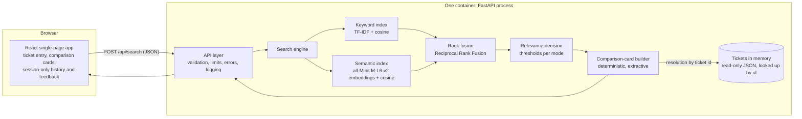

# Solution Design: Support Ticket Similarity Assistant

> **Document status: design stage.** This version was written before the build was complete. Items are tagged **[built]**, **[in progress]** or **[planned]**. No accuracy, latency, test or deployment result is quoted yet, because none has been measured. Detailed walkthroughs are in [TECHNICAL_APPENDIX.md](TECHNICAL_APPENDIX.md).

## 1. The problem, in my own words

Solari Analytics' support team receives about 150 new tickets a day. An agent often does not know that a colleague already solved a very similar ticket, so they investigate from scratch or, worse in the customer's own words, give a different answer than another customer received. Volume is expected to grow.

The assistant does one thing: **for a new ticket, it finds past resolved tickets that look like the same problem, shows their original resolutions word for word, and gives the agent the evidence needed to judge whether a past resolution applies.**

| The application does | The human agent does |
|---|---|
| Retrieves candidate past tickets and ranks them | Decides whether a past ticket is really the same problem |
| Shows the stored resolution verbatim, with the wording both tickets share | Investigates, talks to the customer, and resolves the ticket |
| States differences and unknowns it can read from the text | Performs any refund, reset, account change or closure |
| Says plainly when nothing in the history is a strong match | Handles new kinds of problem from scratch |

The application never executes a fix, never writes a resolution of its own, and never claims a past fix will work.

## 2. Assumptions

The brief leaves these open and asks for them to be stated.

| Assumption | Why |
|---|---|
| "Similar" means *the same symptom in the same product area*, so the past resolution is a sensible first thing to check | Shared words or a shared category are not enough: one past ticket in the export category has the same cause as one in the sync category, and one example ticket shares its topic with a past ticket whose fix would not help |
| The agent pastes or types the ticket; nothing is fetched from a helpdesk | No helpdesk system is named in the brief |
| History is in the tens of thousands of tickets within a year (150 a day is roughly 39,000 to 55,000 a year) | Derived from the stated volume; the growth factor is not given |
| A search should feel instant to an agent (target: well under a second on the supplied data) | No response time is given; **not yet measured** |
| The supplied 40 tickets are a sample, not Solari's history | The brief calls it a seed dataset; 40 tickets is about a quarter of one day's volume |
| Internal tool, synthetic data only, no sign-in | The dataset has no customer or ownership field, so access isolation **cannot be demonstrated and is not claimed** |

Limits of the supplied data that shape the design: new tickets carry only a subject and a description (no category or tags); every past ticket has status "resolved"; there is no record of what the customer was told, no resolution date, and no answer key saying which tickets match.

## 3. Approach

**Preparation (once, at build and start-up):** validate the ticket file; fit the TF-IDF vocabulary; embed every past ticket; load the model once. **Per request:** validate input, score the new ticket against both indexes, fuse the two rankings, decide what is worth showing, and build a card for each result from stored text.

Key decisions:

1. **Two retrievers, because each fails differently.** Keyword search misses a problem described in different words. Meaning-based search treats "Snowflake integration failing" and "HubSpot integration failing" as close. Using both lets one cover the other's gaps; neither is treated as right on its own.
2. **Ranking and relevance are separate steps.** Reciprocal Rank Fusion (RRF) only merges two orderings; its score is the same for a good top result and a poor one. A separate decision step looks at the raw evidence (keyword cosine, embedding cosine, and how much of the new ticket's wording the past ticket covers) and labels each candidate *close match*, *related context* or drops it. The app returns up to three close matches and never pads the list.
3. **Scores are not probabilities.** The interface shows labels and evidence, never a percentage. Raw scores stay in the API for evaluation only.
4. **Honest states.** "Too vague to search", "no strong match", "meaning-based search unavailable (keyword-only results)" and "the service failed" are four different outcomes with different screens.
5. **The comparison card is deterministic.** Every line is either stored text, a word-level comparison, a field that is missing, or a fixed question template. No generative model is used, so nothing can be invented.
6. **One container, no database.** 40 tickets fit in memory and brute-force comparison is instant. A vector database or a second service would add operating cost without changing any result at this size.

## 4. Technology

| Component | Technology | Why | Trade-off |
|---|---|---|---|
| Frontend | React, TypeScript, Vite, plain CSS | My strongest stack; typed API contract shared with the backend | A build step in the container image |
| API | Python 3.12, FastAPI, Pydantic | Typed validation and structured errors with little code | One process per container |
| Keyword search | scikit-learn TF-IDF (words and two-word phrases), cosine | Transparent, fast, no model needed; always available as a fallback | Exact words only; no synonyms |
| Semantic search | Sentence Transformers, `all-MiniLM-L6-v2` (384 dimensions, 256-token window), NumPy cosine | Small CPU model; runs locally, so ticket text never leaves the service | Adds PyTorch to the image; cannot explain its ranking word by word |
| Fusion | Reciprocal Rank Fusion, k = 60 | Combines rankings whose scores are not comparable | Discards score size; cannot say whether any result is good |
| Storage | Read-only JSON, in-memory indexes | Right size for 40 tickets | No live updates; a new file means a new image |
| Packaging and hosting | Docker (multi-stage), Amazon ECR and Amazon ECS Express Mode | One image, HTTPS URL, no cluster to manage | **Deployment is prepared, not performed**; runs continuously while deployed |
| Tests | pytest; Vitest and Testing Library | Standard, fast | Evaluation labels are my own judgements |

Exact versions are pinned in `backend/pyproject.toml`, `backend/uv.lock` and `frontend/package-lock.json`.

## 5. Main trade-offs

- **Hybrid retrieval instead of keyword-only.** Keyword matching alone is a valid first version and is cheaper to run. I kept the semantic retriever because reworded tickets are common in support, and built a tested keyword-only fallback so the model is never a single point of failure. Whether the hybrid actually beats the baseline is an evaluation question, reported in the appendix once measured.
- **Rules instead of a language model for the card.** Rules cannot detect that two differently worded sentences describe different problems. They also cannot make anything up. For a tool whose output an agent may relay to a customer, I chose the second property.
- **Thresholds chosen from a small reviewed query set.** They are tuned on one set of queries and checked once on a separate set built from different source tickets. With 40 tickets they are provisional and must be re-tuned on real data.
- **Text similarity cannot tell "same topic" from "same problem".** A ticket about a reset email that never arrives will retrieve a ticket about a rejected password. The card is the mitigation: it shows the wording side by side and asks the agent to confirm the past ticket's conditions.

## 6. With more time, data or budget

- **Before any real customer data:** sign-in, agent and administrator roles, access filtering applied before ranking and on the ticket-detail endpoint, redaction, retention rules and an audit log. None of these exists today.
- **More data:** precomputed embeddings in a store built for nearest-neighbour search, incremental index updates swapped in as one complete snapshot, and thresholds re-tuned on labelled real tickets.
- **Better judgement:** a field recording whether a resolution is an approved fix, a workaround or outdated; reviewed agent feedback turned into evaluation data; a reranker or a language model only if measurements show which error it would remove.
- **Integration:** the lookup running inside the helpdesk when a ticket is opened.

## 7. What still needs validating with the customer

What "similar" should mean for their agents; real ticket volume, length and language; whether past resolutions may be shown across customers unredacted; the acceptable response time; and whether agents actually use and trust the suggestions, which only reviewed feedback from real use can show.
