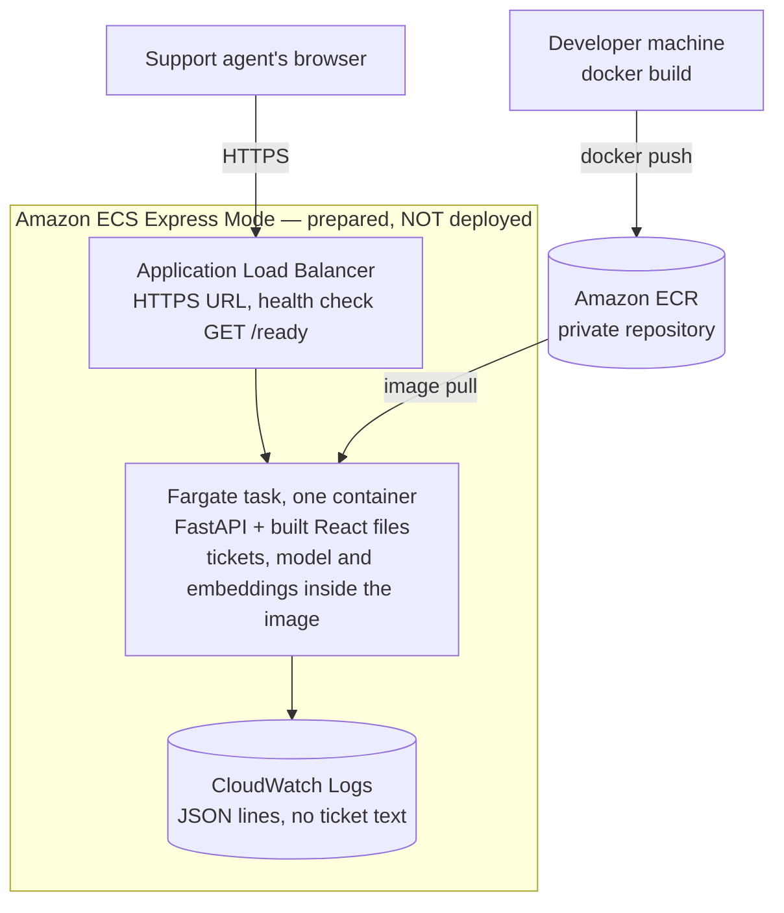
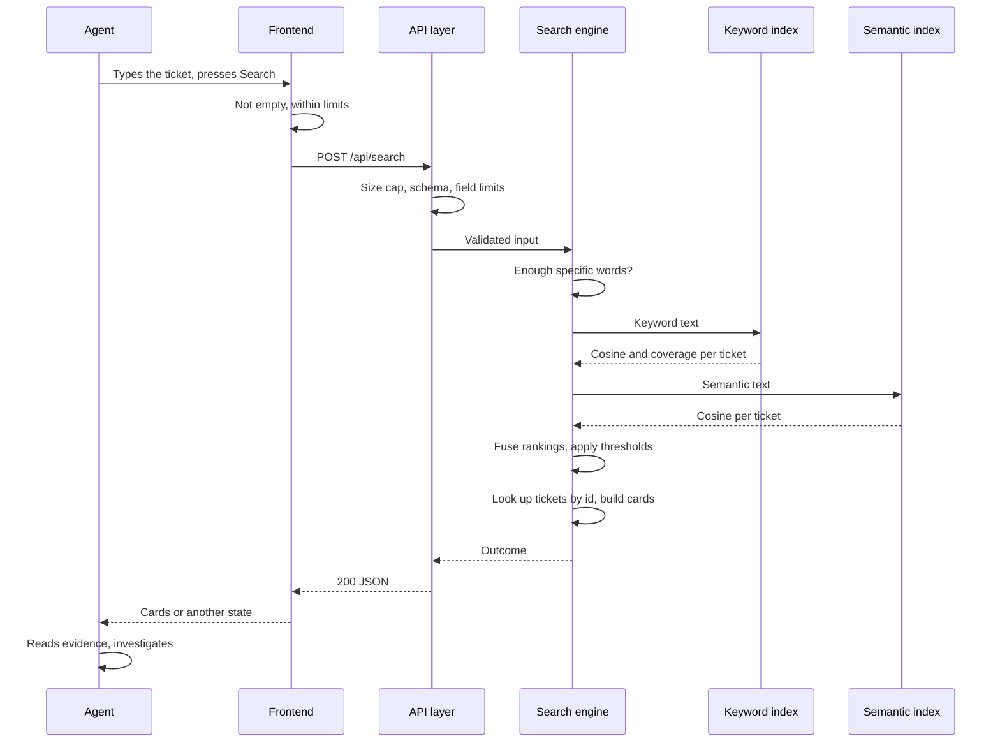

# Technical Appendix: Support Ticket Similarity Assistant

Companion to [SOLUTION_DESIGN.md](SOLUTION_DESIGN.md). Written from the repository as it stands on 2026-11-17. Where a number appears it was measured by a command named in section 9; nothing here is estimated unless it says so. Status words used: **implemented** (in the code and tested), **prepared** (written, not executed), **planned** (not built).

## 1. Scope

| In the MVP (implemented) | Future work (planned) |
|---|---|
| Search by subject and description, with optional product, error detail and category filter | Lookup running inside a helpdesk when a ticket is opened |
| Hybrid retrieval with a tested keyword-only fallback | Reranker, only if measurement justifies it |
| Top 3 / Top 5 selection and explicit summaries of the displayed main matches; provider tested with mocks | Live-provider factual-quality evaluation and measured summarization latency |
| Comparison cards built from stored text and fixed rules | Detection of differences in meaning |
| Recent searches and feedback kept in the browser tab, with JSON export | Central, reviewed feedback store |
| Explicit save of resolved tickets (JSON store or PostgreSQL), indexed immediately, with retry and refresh | Import screen; incremental index updates for very large stores |
| Public demo on synthetic data, no sign-in | Sign-in, roles, access filtering, redaction, retention, audit |
| AWS deployment scripts and instructions (**prepared**) | Deployment performed and observed |

## 2. Architecture

### 2.1 Components

| Component | Responsibility | Source |
|---|---|---|
| React app | Ticket entry, outcome states, comparison cards, session-only history and feedback | [frontend/src/App.tsx](frontend/src/App.tsx), [frontend/src/components/](frontend/src/components/) |
| API layer | Request id, body-size cap, validation, structured errors, security headers, logging, concurrency limit | [backend/app/main.py](backend/app/main.py) |
| Search engine | Holds one immutable snapshot of tickets and indexes; runs the search flow | [backend/app/engine.py](backend/app/engine.py) |
| Ticket loader | Validates the ticket file; rejects and counts bad records | [backend/app/tickets.py](backend/app/tickets.py) |
| Tokenizer | One tokenizer for keyword search and card highlights | [backend/app/text.py](backend/app/text.py) |
| Keyword index | TF-IDF matrix, cosine, coverage | [backend/app/retrieval/keyword.py](backend/app/retrieval/keyword.py) |
| Semantic index | Embeddings, windowing of long input, manifest check | [backend/app/retrieval/semantic.py](backend/app/retrieval/semantic.py) |
| Fusion | Reciprocal Rank Fusion | [backend/app/retrieval/fusion.py](backend/app/retrieval/fusion.py) |
| Relevance decision | Thresholds per retrieval mode | [backend/app/retrieval/relevance.py](backend/app/retrieval/relevance.py), [backend/config/relevance.json](backend/config/relevance.json) |
| Card builder | Evidence, differences, unknowns, questions | [backend/app/cards.py](backend/app/cards.py), [backend/app/signals.py](backend/app/signals.py) |
| Summary service | Signed result references, source-version checks, explicit provider call, coverage validation | [backend/app/summaries.py](backend/app/summaries.py), [frontend/src/components/SummaryPanel.tsx](frontend/src/components/SummaryPanel.tsx) |

The browser talks to the backend only through relative `/api` URLs on the same origin. All backend components run in one Python process and call each other as functions.

### 2.2 Deployment view

The image was built and run locally (section 9). No AWS resource has been created. The scripts in [deploy/aws/](deploy/aws/) and [DEPLOY_AWS.md](DEPLOY_AWS.md) were checked against AWS documentation and run in dry-run mode only.

### 2.3 Where things live

| Thing | Location | Lifetime |
|---|---|---|
| Historical tickets | JSON mode: `/app/data/tickets.json` in the image (unmodified) plus saved tickets in `/app/state/saved_tickets.json`. PostgreSQL mode: the `assistant_tickets` table. In memory after start or refresh | Seed file: until the next image. Saved tickets: as durable as the volume or database |
| Keyword index | In memory; fitted at start from the ticket file | Process |
| Embeddings | `/app/artifacts/embeddings.npy` with `manifest.json`, computed at image build | Until the next image |
| Embedding model | `/app/models/all-MiniLM-L6-v2`, fetched at image build at a pinned revision | Until the next image |
| Recent searches and feedback | The browser tab's session storage | Until the tab closes or "Clear session data" |
| Central feedback or history | None | Not implemented |

### 2.4 Start-up versus per request

**Image build** ([Dockerfile](Dockerfile)): build the frontend; install locked dependencies with CPU-only PyTorch; download the model; compute the 40 embeddings and their manifest with the network disabled.

**Process start** ([backend/app/engine.py](backend/app/engine.py), `SearchEngine.build`): load and validate tickets; load thresholds; fit TF-IDF; load the model once; compare the stored manifest with the running configuration and reuse the embeddings, or recompute them in memory if anything differs.

**Each request:** only the new ticket is tokenized and embedded. Past tickets are never re-embedded.

## 3. Technology

| Component | Technology actually used | Purpose | Why selected | Trade-off |
|---|---|---|---|---|
| UI | React 19.3.1, TypeScript 6.0.3, Vite 8.3.8, plain CSS | Agent workspace | My strongest stack; typed contract in [frontend/src/api/types.ts](frontend/src/api/types.ts) | Build stage in the image |
| API | Python 3.12, FastAPI 0.163.1, Pydantic 2.14.3, Uvicorn 0.54.0 | HTTP, validation, errors | Typed request and response models | Single worker per container |
| Keyword retrieval | scikit-learn 1.9.1 `TfidfVectorizer` with a custom analyzer | Word-overlap ranking; fallback | Transparent and fast on 40 documents | No synonyms or word forms |
| Semantic retrieval | sentence-transformers 6.3.0, PyTorch 2.15.0 (CPU), model `sentence-transformers/all-MiniLM-L6-v2` at revision `1110a243…` | Meaning-based ranking | Small, runs on CPU inside the container | Large image; no word-level explanation |
| Vector maths | NumPy 2.5.5 | Cosine similarity as a dot product | 40 vectors need no index structure | Linear in corpus size |
| Fusion | Reciprocal Rank Fusion, own implementation, k = 60, top 10 from each retriever | One ordering from two | Works on ranks, so score scales do not matter | Says nothing about relevance |
| Storage | JSON file and in-memory structures | Tickets and indexes | Sufficient at this size | No updates without a rebuild |
| Dependency locking | uv (`backend/uv.lock`), npm (`frontend/package-lock.json`) | Reproducible installs | Exact versions and hashes | Base images are pinned by tag, not digest |
| Packaging | Docker, multi-stage | One deployable unit | Same artefact locally and in the cloud | 2.21 GB on disk |
| Hosting | Amazon ECR, Amazon ECS Express Mode | Private registry, HTTPS service | No cluster to manage | **Prepared only**; bills while running |
| Tests | pytest 9.2.0, Vitest 5.1.0, Testing Library, ESLint with accessibility rules | Verification | Fast | See section 9 |

Not used: no vector database, no cache server, no agent framework, no language model, no message queue.

## 4. One search, step by step

Example. Subject: "Customer charged twice". Description: "Two deductions appear for one monthly subscription." The outputs shown were **measured** by sending this request to the running container.

| Step | Input | Operation | Output | Reason |
|---|---|---|---|---|
| A | The agent's ticket | Typed into the form ([TicketForm.tsx](frontend/src/components/TicketForm.tsx)) | Form state | The agent describes the problem |
| B | Form state | `POST /api/search`, JSON body, relative URL ([client.ts](frontend/src/api/client.ts)) | HTTP request | Ticket text stays out of URLs, which get logged |
| C | Request | Body capped at 32,768 bytes before parsing; unknown fields rejected; subject ≤ 200, description ≤ 4,000, product ≤ 80, error detail ≤ 300 characters | Clean fields, or 413 / 422 naming the field | Protects the service; tells the agent what to correct |
| D | Clean fields | Unicode normalized, control characters removed; count specific words (needs at least 2) | Keyword text and semantic text, or `insufficient_input` | Searching on "not working" returns noise. Here: 8 specific words, so the search runs |
| E | Keyword text | Tokenize; transform with the fitted vocabulary (710 features); cosine with all 40 tickets; coverage | Best: T-1303, cosine 0.431, coverage 0.482 | Finds the same words |
| F | Semantic text "Customer charged twice. Two deductions appear for one monthly subscription." | One window (fits in 256 tokens); embed; dot product with 40 stored vectors | Best: T-1303, cosine 0.751 | Finds the same meaning |
| G | Top 10 of each ranking | 1/(60+rank) summed; ties broken by best rank, then id | T-1303 first, fused score 0.0328 | The two score scales are not comparable |
| H | Evidence per candidate | Hybrid rule: semantic ≥ 0.75 and coverage ≥ 0.30, or semantic ≥ 0.90 | T-1303 is a close match; T-1305, T-1103, T-1304 are related context | A ranking always has a top item; that does not make it useful |
| I | Ticket ids | Dictionary lookup | Stored records | The resolution shown is the stored one for that id |
| J | New text and past record | Shared words (charged, twice, monthly, two), differences, unknown fields, questions | Comparison card | Helps the agent judge applicability |
| K | Outcome | Add request id, versions, timing | `status: useful_matches`, one result, three related | One contract for the UI and for evaluation |
| L | Response | Render from the submitted snapshot; ignore superseded responses | One card, related context collapsed | The screen describes the search that was sent |
| M | The card | The agent reads the resolution ("A retry mechanism … double-charged …") and the question asking whether there is any sign of the same | A decision by the agent | The system does not know whether a retry happened here |

## 5. Tokens and algorithms

| Term | Meaning in this project |
|---|---|
| Ticket text | Subject and description as written |
| Word token | One lower-cased word, such as `charged`, produced by [backend/app/text.py](backend/app/text.py) |
| Phrase feature | Two word tokens adjacent in the original text, such as `charged twice` |
| Model subword token | A piece of a word from the embedding model's own vocabulary. Rare words split into several pieces. Only the model uses these |
| Embedding | 384 numbers the model produces for a text; similar meanings point in similar directions |

**Tokenizer.** Lower-cases; keeps digits and underscores inside a token, so `err_conn_reset` and `429` survive; maps "can't", "never", "no" and similar to one negation term instead of dropping them, because the usual English stop-word list removes negations; removes a fixed list of 118 function words; ignores bare numbers shorter than three digits for matching. Tokens carry character positions, so highlights are cut from the original string and the text is never rewritten.

**TF-IDF.** Each past ticket's subject and description become a vector with one number per word or phrase, high when the word is frequent in that ticket and rare across tickets (`sublinear_tf`, L2 normalization, smoothed IDF). The vocabulary is fitted once on the 40 tickets. A new ticket is transformed with the same vocabulary, so a word the history has never seen is dropped.

**Zero keyword overlap.** If none of the new ticket's words is in the vocabulary, the keyword vector is all zeros. The engine reports `keyword_signal: false` (not an error) and no keyword candidates; only semantic evidence remains, and the stricter "semantic alone" threshold applies.

**Coverage.** Because unseen words are dropped, cosine can look high when most of a ticket is unfamiliar. Coverage is the share of the new ticket's distinct words, weighted by rarity, that the past ticket contains, with never-seen words counted against it at full weight.

**Embeddings.** The model reads at most 256 word pieces (confirmed by a test) and was trained on shorter text. Policy: over the character limits, the request is rejected with a message. Within them but longer than the window, the text is split on sentence boundaries into windows that each fit, every window is embedded, and a past ticket's score is its best score over the windows. Nothing is silently cut off; the response reports `semantic_windows`.

**What is reused.** The 40 embeddings are computed once at build time. `manifest.json` records the ticket-file hash, ordered ticket ids, model id and revision, vector size, token limit and text template. Any mismatch at start means the embeddings are recomputed and the start-up log says `rebuilt_at_startup`.

**Cosine similarity.** The dot product of two vectors divided by the product of their lengths. Both indexes store unit-length vectors, so it is one dot product.

**Reciprocal Rank Fusion.** Each ticket scores the sum of 1/(60 + rank) over the two rankings. With two lists the maximum is 2/61 = 0.0328, reached by any ticket ranked first in both, however weak. It orders candidates and is never used to decide relevance.

**Not probabilities.** A cosine of 0.75 is not a 75% chance that the fix works. It says two texts are alike under one method. Tickets worded alike can have different causes.

**Thresholds.** In [backend/config/relevance.json](backend/config/relevance.json), version `2026-11-17.1`, with the observations that led to them. Chosen on the tuning set by reading the evidence of the expected ticket and of the strongest other ticket for every query. Several margins are only 0.03 to 0.04 wide. They are provisional and must be re-tuned when the tickets, model or keyword settings change.

## 6. Features

### 6.1 Comparison card (implemented)

| Shown | How it is produced |
|---|---|
| Id, subject, category, status, tags, created date | Stored record, by id |
| Original resolution | Stored `resolution_notes`, unchanged |
| Highlights, side by side | Tokens whose term is in both tickets, cut by character position. Very common words (in more than 20% of tickets) and negations are not highlighted as evidence |
| Words in both tickets | The same shared terms, rarest first, at most 8 |
| Words one ticket uses and the other does not | Set difference of terms, at most 6 each, captioned "exact words only … absent means not stated, not different" |
| Products, systems or named terms | The agent's own entry; otherwise words capitalised inside a sentence, plus names the history writes that way |
| Error codes | The agent's own entry; otherwise code-shaped tokens or a three-digit number beside "error", "status" or "code" |
| Unknown | Any field one side lacks. The outcome is `unknown`, never `different` |
| Questions (at most 3) | Fixed templates: differing names; differing codes; the first sentence of the resolution notes quoted with "Is there any sign of the same in the new ticket?"; words only the past ticket uses |
| Other tickets mentioned | Known ticket ids found in the past ticket's own text |

The rules compare words, not meaning. They cannot tell that "email never arrives" and "password rejected" are different problems. They put both texts side by side and point at the differing words.

### 6.2 Supporting features (implemented)

Load a supplied example (fills the form only); clear and search again; expandable full record fetched from `GET /api/tickets/{id}`; category filter, never applied automatically, with a count of close matches it hides; optional product and error-detail fields; refinement suggestions, each with its basis; loading, validation, no-match, insufficient-input, degraded and service-error states; manual Retry with no automatic retries; a 15-second client timeout; stale responses discarded; keyboard-accessible form and a live status region.

**Recent searches and feedback are session-only.** They live in the browser tab's session storage, are never sent to the server, can be exported as JSON and cleared, and do not change the search.

### 6.3 Selectable results and summaries (implemented; live provider not verified)

`top_k` is a strict integer enum, 3 or 5, default 3. It limits the final main matches after ranking and relevance filtering, including the exact-text-match path. Below-threshold context retains its existing separate limit and is excluded from summaries. The former `MAX_USEFUL_RESULTS` environment setting is retired so it cannot silently override the user's selection.

Changing the dropdown after a search runs the current query and filters again. Search never calls an LLM. A completed search with matches includes a signed, 15-minute `summary_token` binding the query, requested count, ordered main-match IDs, their content revisions, and the configured proxy identity if present. This token is readable, not encrypted. It stays in component state, never in session storage, feedback exports or URLs. It is not authentication or tenant isolation. Multi-replica deployments need a shared `SUMMARY_SIGNING_KEY` secret; otherwise tokens work only on their issuing process and become invalid on restart.

`POST /api/summaries` accepts `{summary_token, ticket_ids}`. The service verifies the exact ordered list, reloads canonical records and checks their revisions before and after generation. Changed, deleted, reordered or expired references produce 409 `summary_refresh_required`. No new search runs during summarization. Unsupported input, including caller-supplied resolution text, is rejected.

One explicit click produces at most one OpenAI Responses API call, with `store: false`, strict structured output, no tools and no automatic retries. The default model is `gpt-4o-mini`, configurable through `SUMMARY_MODEL`. `OPENAI_API_KEY` stays server-side. The full source payload is bounded to 30,000 characters; excessive input is rejected without silently dropping or truncating tickets. The backend has two summary slots separate from search concurrency, a 35-second provider timeout and a 3,000-token output cap. The UI has a 60-second timeout and aborts/ignores superseded work. Aborting a browser request does not guarantee cancellation of work already accepted by the provider.

Output contains cited overview points, one issue/resolution entry per displayed source in order, and applicability notes limited by the prompt to supported differences or unknowns. The backend and UI both validate IDs, coverage and ordering; the UI renders text safely. These checks do not prove semantic faithfulness or prevent every prompt-injection attempt. Compare generated text with original records. Nothing is saved as a new resolution, no score or match label changes, and no summary cache or database is introduced.

Unconfigured credentials, provider failures, incomplete/refused/malformed output and stale sources have separate error messages. Search and readiness remain usable. Automated tests use a fake provider plus HTTP transport mocks; no live provider request or paid model-quality evaluation has been performed for this change. Configuration is documented in [README.md](README.md#optional-summaries-of-top-3--top-5-results).

## 7. Data model and API

Historical ticket: `ticket_id`, `subject`, `description`, `resolution_notes` are required; `category`, `status`, `tags`, `created_at` are shown when present. Tickets whose status is present and not `resolved` are not indexed.

| Endpoint | Responsibility |
|---|---|
| `POST /api/search` | Run a search with `top_k: 3` or `5`; return the selected count and signed summary reference |
| `POST /api/summaries` | Summarize exactly the displayed main matches by signed reference and ordered IDs |
| `GET /api/tickets/{ticket_id}` | One stored ticket |
| `GET /api/examples` | The supplied example tickets |
| `GET /api/meta` | Limits, categories, versions, counts |
| `GET /health` | Liveness: always 200 while the process runs |
| `GET /ready` | Readiness: 200 when a search mode is usable, 503 otherwise |

Search request: `subject`, `description`, optional `product`, `error_detail`, `category`. Search response: `request_id`, `query_fingerprint`, `status`, `message`, `results` (0 to 3), `related` (0 to 3), `query_insights`, `retrieval` (mode, degraded flag and reason, `index_version`, `model_id`, `model_revision`, `relevance_config_version`), `timing_ms`. Full types: [frontend/src/api/types.ts](frontend/src/api/types.ts) and [backend/app/schemas.py](backend/app/schemas.py).

| Situation | Response |
|---|---|
| Close matches | 200 `useful_matches` |
| None passes the threshold | 200 `no_strong_match` |
| Too vague | 200 `insufficient_input` |
| A retriever unavailable | 200 with `retrieval.degraded: true` |
| Empty, over-limit, unknown field or category | 422 with field details; the rejected input is never echoed |
| Body too large | 413 `request_too_large` |
| All search slots busy | 503 `busy` |
| No retriever usable | 503 `search_unavailable` |
| Unexpected failure | 500 `internal_error` |

**Keeping ids attached to the right text.** Both indexes are built from the same accepted ticket list and each keeps its ordered ids. A result is an id; text is fetched from a dictionary keyed by id. Records with a conflicting duplicate id are all rejected. Tests confirm each ticket retrieves itself, that every card shows the stored record for its id, and that shuffling the file changes nothing.

## 8. Failures, security and reliability

| Case | Behaviour | Tested |
|---|---|---|
| Empty input | 422 `empty_input`, field message, no search | Yes |
| Vague input | `insufficient_input`; retrieval does not run | Yes |
| Unfamiliar issue | `no_strong_match`. The screen shows "No relevant historical match found", the escalation link and "Record resolution", and no past-ticket cards (the API still returns related context) | Yes |
| Misleadingly similar ticket | Can still be labelled a close match. Mitigated by the card, not solved | Measured in section 9 |
| Negated symptom | Indistinguishable to both retrievers. Known limit | Measured |
| Zero keyword overlap | No keyword signal; semantic evidence only | Yes |
| Bad records | Rejected with reason codes; counts in `/api/meta` | Yes |
| No valid tickets, or unusable file | `/ready` is 503; search is 503, not "no match" | Yes |
| Model fails to load | Keyword-only mode, flagged; `/ready` stays 200 | Yes |
| Model fails during a request | That request answers keyword-only; after three failures the model is switched off until restart | Yes |
| Timeout, stale response | 15-second client timeout; only the latest search is rendered | Yes (frontend) |
| Untrusted text | React text nodes only; strict content security policy; markup stays inert | Yes, and observed in a browser |
| Logs | Ids, counts, timings, versions. No ticket text, no search terms. A marker string sent through success, validation and failure paths never appears | Yes |
| Load | Body cap; 4 concurrent searches, then 503 `busy` | Yes |

**Limits to state openly.** No sign-in and no permission model. The ticket-detail endpoint is as public as search. No tenant isolation is implemented or claimed. No per-client rate limit. The readiness check does not prove result quality.

## 9. Testing and evaluation

### 9.1 Tests that were run

| Suite | Command | Result |
|---|---|---|
| Backend | `uv run pytest` in `backend/`, with `TEST_DATABASE_URL` pointing at a local PostgreSQL 17 | 140 passed (including 14 PostgreSQL integration tests) |
| Frontend types | `npm run typecheck` | Passed |
| Frontend tests | `npm test` | 56 passed in 6 files |
| Frontend lint | `npm run lint` | No problems |
| Frontend build | `npm run build` (also inside the image build) | Passed |

Backend tests cover the items in section 8 plus the real model's limits, windowing of long input, manifest mismatch, deterministic fusion, and a scan confirming no dataset ticket id appears in application code.

### 9.2 Retrieval evaluation

Data: [backend/evaluation/data/](backend/evaluation/data/). Command: `uv run python -m evaluation.run --set tuning|final`. Results: [backend/evaluation/results/](backend/evaluation/results/).

- 52 queries: 28 tuning (24 written for the purpose plus the 4 supplied examples) and 24 final.
- The sets share no source ticket: tuning queries are built around tickets with odd ids, final queries around even ids.
- Types: near-verbatim, reworded, misleading, negation, different product, unfamiliar, vague.
- Each query was labelled when written and again independently without sight of the first labels. All 52 agreed. Both passes were made with an AI assistant from the ticket texts; they are judgements, not ground truth, and should be reviewed by a person before the numbers are quoted.
- Thresholds were chosen on the tuning set, frozen, and the final set was run once.

| Measure | Set | Hybrid | Keyword only | Semantic only | Starter-kit scorer |
|---|---|---|---|---|---|
| Expected ticket shown as a close match | Tuning (14) | 8 | 8 | 8 | n/a |
| | Final (12) | 5 | 5 | 6 | n/a |
| Expected ticket ranked in the first three | Tuning (14) | 12 | 10 | 14 | 9 |
| | Final (12) | 10 | 7 | 12 | 8 |
| Reworded queries ranked in the first three | Final (6) | 4 | 1 | 6 | not separated |
| A ticket wrongly shown as a close match | Tuning (13) | 1 | 1 | 1 | n/a |
| | Final (11) | 0 | 3 | 1 | n/a |
| Vague query reported as insufficient input | Both (1 each) | 1 | 1 | 1 | n/a |

Reading the table:

- Near-verbatim tickets: 8 of 8 (tuning) and 5 of 6 (final) are labelled close matches. The one miss had coverage 0.269 against a threshold of 0.30.
- Reworded tickets: none is labelled a close match in any mode. Their semantic cosines (0.33 to 0.63) overlap those of unrelated tickets. The API returns them as related context, but the no-match screen does not show related cards, so the agent does not see them.
- Semantic search alone ranked best here. The hybrid ranks better than keyword-only and the starter scorer, and made the fewest false matches on the final set.
- The tuning-set false match is a negation query. The supplied "reset email never arrives" example is correctly not labelled a close match with these thresholds, by a coverage margin of 0.03.
- Keyword settings: words only versus words and phrases made no difference to ranking on the tuning set (10 of 14 either way); light stemming was slightly worse (9 of 14). Phrases are left on; stemming is off.
- The starter-kit scorer always returns three tickets, so it has no "no match" behaviour to measure.

### 9.3 Container checks (measured locally)

| Check | Result |
|---|---|
| `docker build` | Succeeded |
| Image | linux/amd64, 2.21 GB on disk, user 10001 |
| Start with `--network none --read-only --cap-drop ALL --memory 2g --cpus 1` | Ready in about 10 seconds; start-up log reports 4.0 seconds, embeddings from the stored artefact, 40 tickets accepted |
| Memory after 30 searches | About 365 MiB |
| Latency, 30 sequential searches over HTTP, one CPU | Median 29 ms, 95th percentile 91 ms, maximum 109 ms |
| Ticket file and model through the web server | 404 on every path tried |
| Real browser (headless Chrome) | Close match, no strong match, insufficient input and injected markup all rendered correctly; no console errors |

Latency in the evaluation result files is higher because that run happened while other builds were using the machine; the figures above are the cleaner measurement. None of these numbers describes AWS.

### 9.4 AWS package

Scripts parse without errors and their dry-run mode prints the commands without calling AWS. The create command's parameters, both IAM policy names and both trust policies match the AWS CLI reference and the Express Mode getting-started guide. **Nothing has been run against an AWS account.** The update, rollback and cleanup scripts were not checked line by line against the documentation.

## 10. Trade-offs and future work

**Why this fits the scope.** 40 tickets, one user at a time, a four-hour build. Everything is in one process, so there is nothing to keep in sync and one thing to deploy.

**Deliberately deferred.** A central feedback store, an import screen, authentication, a vector store, per-client rate limiting and digest-pinned base images. Ticket persistence and optional displayed-result summaries are now implemented; live summary quality still needs evaluation.

**What changes with scale.**

| More of | Change |
|---|---|
| Tickets (thousands and up) | Precompute embeddings offline; use a nearest-neighbour index; build a complete new snapshot and switch to it in one step |
| Users | More tasks behind the load balancer; rate limiting at the edge |
| Time | Human-reviewed labels from real tickets; re-tuned thresholds; a status for resolutions (approved, workaround, outdated) |
| Budget | A reranker or language model, where the evaluation shows which error it removes |

**Before real customer data.** Sign-in through the company identity provider; agent and administrator roles; access filtering applied before ranking and again on the ticket-detail endpoint; redaction at ingestion; a retention period for every copy, including old images and logs; an audit trail.

**Assumptions still to validate.** The meaning of "similar"; real ticket length, language and writing style; whether resolutions may be shown across customers; the acceptable response time; whether agents use the suggestions.

## 11. Missing evidence and inconsistencies

1. **AWS deployment has not been performed.** Deployment status, URL, cold-start time and cost are unknown.
2. **AWS documentation disagrees with itself** on the unit of `--cpu` and `--memory` (units and MiB in the CLI reference; `2` and `4` in a guide example). The scripts send 1024 and 2048; [DEPLOY_AWS.md](DEPLOY_AWS.md) marks the step "verify before running".
3. **Labels were not reviewed by a person.** Both labelling passes were AI-assisted.
4. **Samples are small.** 12 matchable and 11 no-match queries in the final set; one query is about 8 percentage points.
5. **The hybrid did not rank best.** Semantic-only ranked more expected tickets in the first three. The hybrid is kept for the fallback and for exact identifiers, which this query set barely exercises.
6. **The earlier design-stage version of this document** said a search would feel "well under a second" as an assumption. That is now measured locally, not on AWS.
7. **The brief's framing differs from "hackathon".** It describes a take-home case study with no cloud requirement and no scoring weights; those came from separate instructions.
8. **Base images are pinned by tag,** so a rebuild months later may pick up a newer patch release.
9. **Tests for the frontend use invented fixtures.** The real backend was exercised through the browser check in section 9.3, not through the automated frontend tests.
